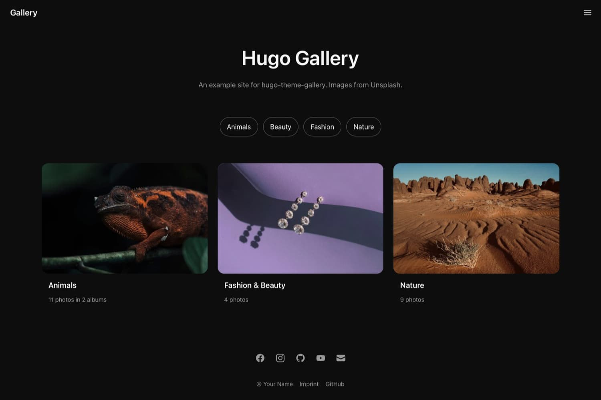
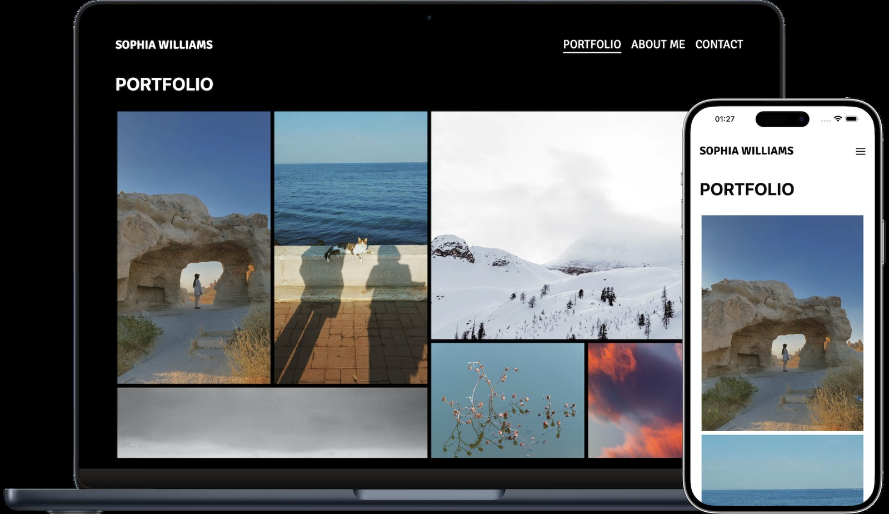
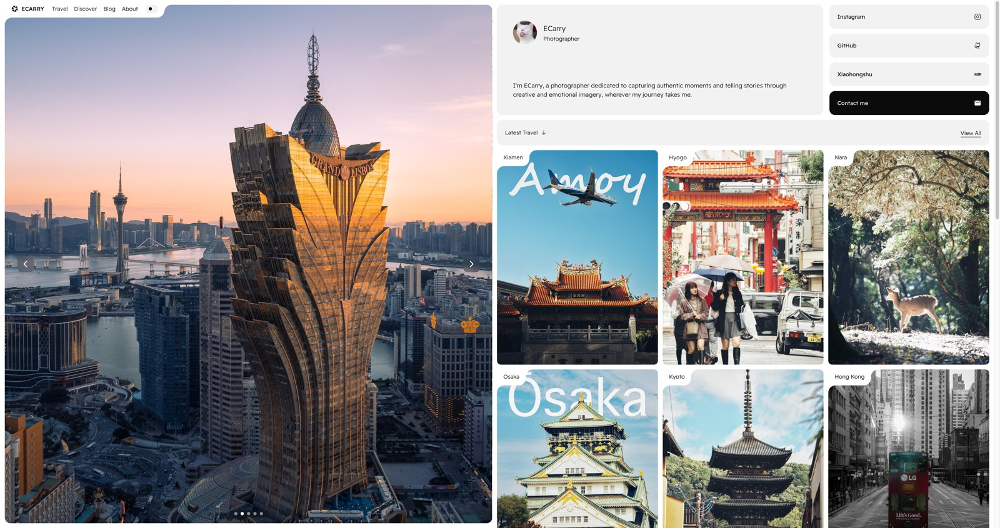
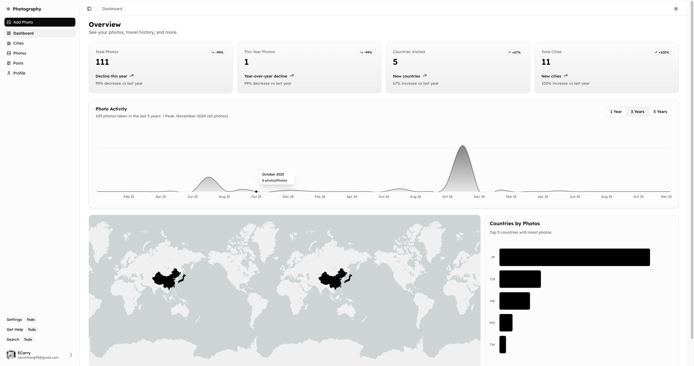
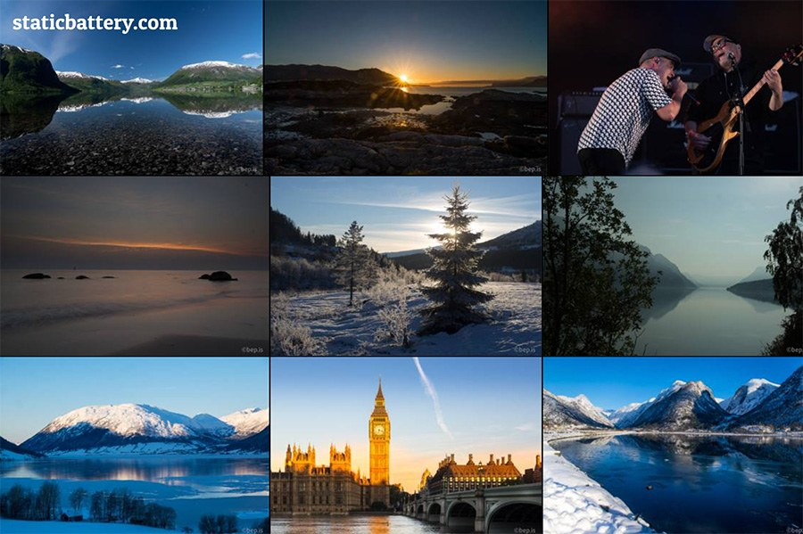

# Референсы для нашего семейного альбома

Подборка от 12 ноября 2026. **Сайт проекта не менялся: это только исследование.**

Ищу спокойное оформление с характером: фотографии на первом плане, понятные альбомы, минимум украшений. Учитываю твоё пожелание: вечером экран не должен слепить.

Прямой доступ к большинству внешних сайтов в этой среде ограничен. Поэтому основная подборка основана на реальных изображениях, опубликованных авторами в открытых GitHub-репозиториях: я открыл и просмотрел эти изображения и README. Это **не свежие скриншоты работающих сайтов**. Анимации, скорость, мобильное поведение и удобство действующих сайтов не проверены. Некоторые примеры — демонстрационные темы, а не коммерческие проекты премиум-класса.

Оценки субъективные: «дизайн» — композиция на опубликованном изображении; «для нас» — насколько подход можно применить к семейному альбому. Это не оценка качества программного кода. Палитры ниже — мои предложения для нашего проекта, не извлечённые CSS-цвета сайтов.

## Быстрый выбор

| Пример | Дизайн | Для нас | Что рассмотреть |
|---|---:|---:|---|
| Hugo Gallery | 8/10 | **9/10** | Главная с обложками альбомов |
| Sophia Williams / João Franco | 8/10 | **8/10** | Сетка снимков внутри альбома |
| ECarry Photography | 8/10 | **7/10** | Выразительная обложка и группировка поездок |
| Static Battery / Gallery Deluxe | 7/10 | **7/10** | Режим просмотра большого количества фото |

## 1. Hugo Gallery — лучший ориентир для структуры

[Открыть демо](https://nicokaiser.github.io/hugo-theme-gallery/) · [Репозиторий и источник](https://github.com/nicokaiser/hugo-theme-gallery)

**Моя оценка: дизайн 8/10 · пригодность для нас 9/10.**

Что нравится: спокойная тёмная основа, крупные фотографии-обложки, короткие подписи и заметное разделение на альбомы. Нет ощущения рекламного лендинга. Пользователь сразу понимает, куда нажимать.

Что взять: на главной показывать не все фотографии подряд, а события: «Лето на даче», «Свадьба родителей», «Наши поездки». Под обложкой — год и количество снимков. Вместо категорий Animals / Nature — «Семья», «Поездки», «Праздники».

Что я бы улучшил: белые заголовки на почти чёрном фоне для вечера слишком контрастные. Сделал бы графитовый фон и тёплый светло-серый текст. Социальные значки внизу для семейного архива не нужны.

**Наше возможное сочетание:** фон `#222624`, текст `#CFD0C6`, акцент `#A6B394`. Заголовки Onest, подписи Golos Text.

Из README: есть тёмная схема, альбомы, PhotoSwipe и отметка private. Последняя скрывает альбом из списков — сама по себе это не авторизация и не защита семейных фотографий.

[Оригинал изображения](https://raw.githubusercontent.com/nicokaiser/hugo-theme-gallery/main/images/screenshot.jpg)

## 2. Sophia Williams — фотографии важнее оформления

Автор реализации: João Franco. Sophia Williams — **вымышленный фотограф**, как прямо указано в README.

[Демо из README](https://photography-portfolio-joaofranco03.netlify.app/) · [Репозиторий и источник](https://github.com/JoaoFranco03/photography-portfolio)

**Моя оценка: дизайн 8/10 · пригодность для нас 8/10.**

Что нравится: фотографии разных пропорций образуют цельную композицию. Нет рамочек вокруг каждой карточки и лишних декоративных элементов. На опубликованном макете видно, как широкая сетка превращается в последовательность снимков на телефоне.

Что взять: такую сетку использовать внутри конкретного альбома. Вертикальные кадры оставить вертикальными, горизонтальные — горизонтальными. Между снимками нужны небольшие, одинаковые промежутки.

Что я бы улучшил: чистый чёрный и белый создают жёсткий контраст. Крупные надписи PORTFOLIO подходят фотографу, но для семьи лучше название события, дата и несколько личных строк. Телефон на изображении светлый — для нас важно, чтобы выбранная тёмная тема сохранялась на всех экранах.

**Наше возможное сочетание:** фон `#252526`, текст `#CFCCC6`, акцент `#B49D87`. Заголовки Lora, подписи Golos Text.

[Оригинал изображения](https://raw.githubusercontent.com/JoaoFranco03/photography-portfolio/main/dist/assets/mockup.png)

## 3. ECarry Photography — выразительная обложка и истории поездок

[Репозиторий, описание и источники](https://github.com/ECarry/photography-website). В рамках этой проверки подтверждён именно репозиторий и опубликованные изображения; адрес действующего публичного сайта не установлен.

**Моя оценка: дизайн 8/10 · пригодность для нас 7/10.**

Что нравится: один большой снимок задаёт настроение, а небольшие подборки позволяют продолжить просмотр. Изображения дают ощущение настоящего личного архива, а не страницы с абстрактными декоративными блоками.

Что взять: один главный семейный снимок и несколько последних альбомов рядом или ниже. Поездки можно группировать по местам и годам. На главной не обязательно показывать всю библиотеку.

Что я бы улучшил: слишком много разных зон для небольшого семейного проекта. Ссылки на соцсети, контакты и большая биография отнимают место у воспоминаний. Светлые панели на изображении вечером будут яркими. Огромные названия поверх снимков могут закрывать лица.

**Наше возможное сочетание:** фон `#202A30`, текст `#C6D0D4`, акцент `#8FB4BF`. Заголовки Onest, основной текст Golos Text.

### Дополнительно: ориентир для будущей панели управления

Здесь полезна идея отдельного пространства для загрузки фотографий и управления альбомами. Графики и карты для первой версии нашего проекта избыточны. Нужнее понятные действия «Добавить фото», «Создать альбом», «Изменить подпись».

README описывает базу PostgreSQL, S3-совместимое хранилище и авторизацию. Я их не запускал и не проверял: наличие в описании не означает, что мы уже получили готовую работающую базу для нашего проекта.

[Оригинал главной](https://raw.githubusercontent.com/ECarry/photography-website/main/screenshots/home.png) · [Оригинал панели](https://raw.githubusercontent.com/ECarry/photography-website/main/screenshots/dashboard.png)

## 4. Static Battery / Gallery Deluxe — погружение в фотографии

[Сайт из README](https://staticbattery.com/) · [Репозиторий и источник](https://github.com/bep/gallerydeluxe)

**Моя оценка: дизайн 7/10 · пригодность для нас 7/10.**

Что нравится: снимки занимают почти весь экран. Почти нет интерфейса, который отвлекает от просмотра. Это хороший ориентир для дополнительного режима «Все фотографии».

Что взять: плотную сетку и возможность перейти от миниатюры к большому снимку. Для семейного альбома такая сетка особенно полезна после выбора года или события.

Что я бы улучшил: на главной теряется история — непонятно, когда и с кем сделаны фотографии. Без разделения на события большой архив станет тяжело просматривать. Между снимками я бы оставил чуть больше воздуха и добавил доступные по нажатию подписи.

**Наше возможное сочетание:** фон `#232522`, текст `#C9CBBF`, акцент `#ADB18B`. Заголовки Literata, подписи Onest.

[Оригинал изображения](https://raw.githubusercontent.com/bep/gallerydeluxe/main/images/tn.jpg)

## Что я рекомендую именно нам

**Основной ориентир — Hugo Gallery.** У него самая подходящая для семейного архива структура: события и альбомы с понятными обложками. Внутри альбома можно использовать свободную сетку, как у Sophia Williams. От ECarry взять идею одной сильной обложки; плотный просмотр Gallery Deluxe оставить дополнительным режимом.

Это ориентиры для своей композиции. Не нужно переносить чужие фотографии, названия, логотипы и весь внешний вид.

Мой фаворит по цветам: **тёплый графит `#222624` + мягкий текст `#CFD0C6` + шалфей `#A6B394`**. Более домашняя альтернатива: шоколад `#2D2522` + текст `#D5C8BA` + тёплый акцент `#C39B7C`.

Для вечера я бы избегал чистого белого текста на чистом чёрном, ярких цветных кнопок и больших белых панелей. Но фотографии сами могут быть светлыми: тёмный интерфейс не гарантирует комфорт каждому человеку. Приглушение фотографий лучше делать отдельной настройкой, чтобы не искажать их постоянно.

## Дополнительные премиальные ориентиры — пока без проверенных изображений

Эти адреса проверены запросом, но доступ заблокирован сетевой политикой среды. Я **не оцениваю их актуальный дизайн** и не подставляю выдуманные скриншоты. Их стоит посмотреть вручную отдельно:

- [Artifact Uprising](https://www.artifactuprising.com/) — фотокниги и подача семейных воспоминаний.
- [Kinfolk](https://www.kinfolk.com/) — журнальная композиция и работа с фотографией.
- [Papier](https://www.papier.com/) — цвет и характер бумажных изделий.
- [Awwwards: Photography](https://www.awwwards.com/websites/photography/) — каталог для дальнейшего поиска.

## Источники изображений и границы проверки

Все пять картинок выше — уменьшенные копии изображений из README/репозиториев авторов, с прямыми ссылками на оригиналы рядом с соответствующим примером. Изображения используются для обсуждения и сравнения; авторство дизайна и фотографий остаётся у их владельцев. Они не добавлены в приложение альбома.

Источники README: [Hugo Gallery](https://github.com/nicokaiser/hugo-theme-gallery/blob/main/README.md), [João Franco](https://github.com/JoaoFranco03/photography-portfolio/blob/main/README.md), [ECarry](https://github.com/ECarry/photography-website/blob/main/README.md), [Gallery Deluxe](https://github.com/bep/gallerydeluxe/blob/main/README.md).

Поиск: [GitHub — photography portfolio website](https://github.com/search?q=photography+portfolio+website&type=repositories). Звёзды и место в поиске не использованы как оценка дизайна.
